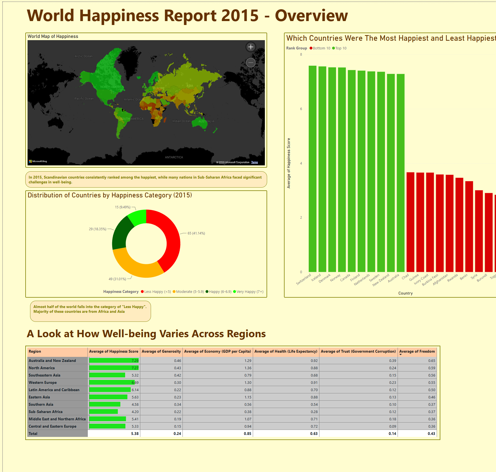
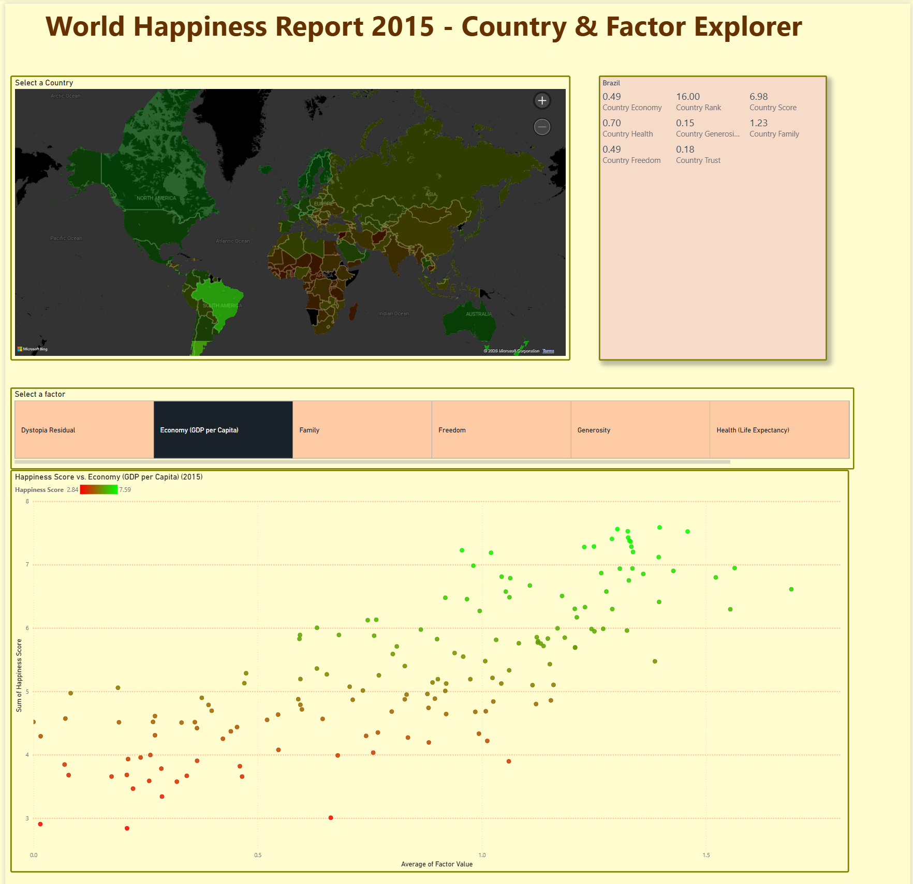
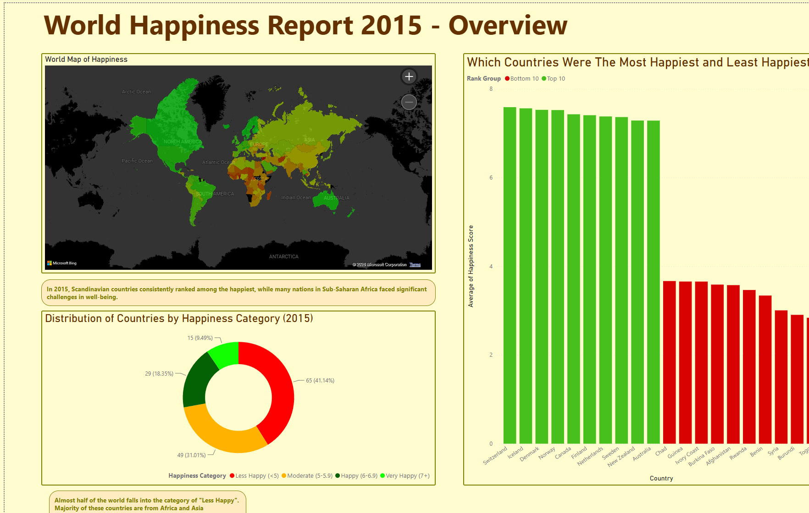
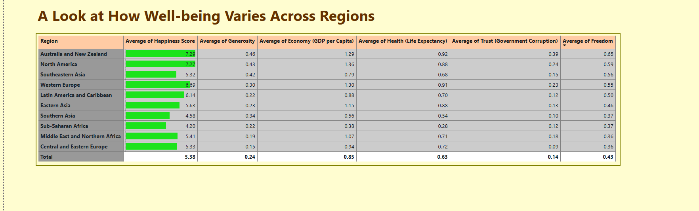
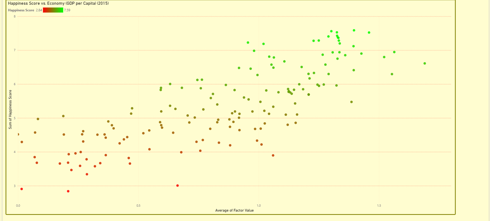

# World Happiness Report 2015 — Power BI Dashboard

An interactive Power BI analytics dashboard analyzing global happiness levels, regional disparities, and key socio-economic drivers across 158 nations using the World Happiness Report 2015 dataset.

---

## Dashboard Overview

### Page 1: Overview & Regional Insights
A macro view of global well-being, highlighting top and bottom performers, category distributions, and regional variance across six core factors.



#### Key Highlights & Observations:
- **Global Leaders vs. Trailing Nations:** Scandinavian countries (Switzerland, Iceland, Denmark, Norway) dominate top positions with happiness scores above 7.5. Conversely, nations in Sub-Saharan Africa and conflict zones (Burundi, Syria, Togo) record scores below 3.5.
- **Global Happiness Distribution:**
  - **41.14%** (65 countries) classify as *Less Happy* (< 5.0).
  - **31.01%** (49 countries) fall into *Moderate* (5.0 - 5.9).
  - **18.35%** (29 countries) rank *Happy* (6.0 - 6.9).
  - **9.49%** (15 countries) achieve *Very Happy* (7.0+).
- **Regional Breakdown:** Australia & New Zealand (7.29) and North America (7.27) lead average regional happiness, buoyed by higher GDP per capita, strong social support, and healthy life expectancy.

---

### Page 2: Country & Factor Explorer
An interactive deep-dive canvas allowing users to inspect individual country scorecards and evaluate how specific factors correlate with overall happiness.



#### Features:
- **Choropleth Country Map:** Dynamic visual filter linked to the country metrics card.
- **Country KPI Scorecard:** Displays rank, score, economic contribution, family/social support, health (life expectancy), freedom, generosity, and trust in government upon selecting any country.
- **Factor Correlation Scatter Plot:** Plots all 158 nations across factor values against total happiness score, showing strong linear associations—particularly for Economic output (`GDP per Capita`) and Social support (`Family`).

---

## Visual Showcase

### Top 10 vs. Bottom 10 Comparison


### Regional Well-being Matrix


### Happiness Score vs. Economy (GDP per Capita)


---

## Repository Structure

```text
├── data/
│   └── World_Happiness_2015.csv              # Raw dataset (158 countries, 12 indicators)
├── pbix/
│   └── World_Happiness_Report_2015_Dashboard.pbix # Full Power BI report file
├── docs/
│   └── assets/                               # High-resolution dashboard captures & slide cards
└── README.md
```

---

## Dataset & Metrics

The analysis leverages data from the **Gallup World Poll** as published in the World Happiness Report:

| Indicator | Description |
| :--- | :--- |
| **Happiness Score** | National average evaluation of life based on the Cantril ladder question (0 to 10). |
| **Economy (GDP per Capita)** | Purchasing power parity (PPP) adjusted GDP contribution to happiness score. |
| **Family (Social Support)** | Having someone to count on in times of trouble. |
| **Health (Life Expectancy)** | Healthy life expectancy at birth. |
| **Freedom** | Freedom to make life choices without undue restriction. |
| **Trust (Government Corruption)** | Public perception of widespread corruption in government and business. |
| **Generosity** | Recent charitable donations adjusted for national income. |
| **Dystopia Residual** | Baseline value equal to the lowest observed national scores plus error term. |

---

## How to View
1. Clone or download this repository:
   ```bash
   git clone https://github.com/Samurai412/World-Happiness-Report-2015.git
   ```
2. Open `pbix/World_Happiness_Report_2015_Dashboard.pbix` using **Power BI Desktop**.
